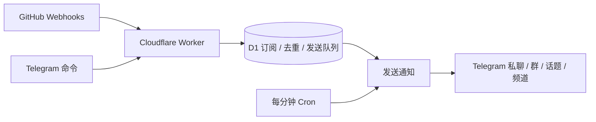

# Github-TG-Bot

[](https://github.com/KiritoXDone/Github-TG-Bot/actions/workflows/ci.yml)

运行在 **Cloudflare Workers + D1** 上的 GitHub → Telegram 通知机器人。订阅自己拥有或参与协作的仓库，在 Telegram 接收 Issue、PR、Commit、Release 等动态。支持公开和私有仓库，无需 VPS、Docker、MongoDB 或 GitHub Token。

这是一个独立的 Workers 实现。GitHub 通过 Webhook 推送事件；Telegram 命令通过 Telegram Webhook 接收，没有常驻进程或 API 轮询。

## 功能

- `/sub owner/repo` 订阅；个人、群聊、群话题、频道分别管理订阅及事件类型。
- 私聊中使用 `--to me`、`--to @频道名`、`--to 群ID` 指定通知目标；无需修改 Cloudflare 配置。
- `/targets` 查看通知目标，`/target add` 连接目标，`/target remove` 停用目标并清理其订阅。
- 默认推送 Issues、PR、Commits、Releases；可选评论、Review、Actions、Stars、Forks。跳过草稿 Release 和草稿 PR，正式发布 / 转为待审核后正常通知；预发布仍会通知。
- GitHub HMAC-SHA256 签名校验、Telegram Webhook Secret、用户及聊天白名单。
- D1 原子写入事件与消息队列，防止重复 Webhook 导致重复入队。
- 新 Release 仅由 `published` 触发，忽略同一次发布附带的 `created` / `released` / `prereleased`；按仓库、Release ID、发布时间去重，避免不同投递 ID 重复通知。已发布版本的编辑、删除和撤回仍会通知。
- 消息入库后立即尝试发送；每分钟 Cron 重试限流、超时和临时错误。
- 支持 Telegram 群话题，长列表分页，长通知截断并保留 GitHub 原文链接。
- Push 收到多少个 Commit 就展示多少个；超长自动分页并按顺序投递，限流后从未发送的页继续。
- 通知使用 GitHubBot 风格的 MarkdownV2 排版：首行是事件和对象链接，作者另起一行；Push 用提交数量链接到 Compare，每条提交显示短哈希、摘要和作者，作者可点击跳转 GitHub 主页（需事件提供关联账号）。Release、Issue、PR、评论、Review 正文渲染 Markdown 的标题、粗斜体、删除线、列表、引用、链接和代码，截断时保留完整格式和链接。
- GitHub `<details><summary>…</summary>…</details>` 转为 Telegram 可展开引用块，summary 显示为粗体标题，内部正文继续解析 Markdown；带 `open` 时保持展开，嵌套折叠内容展平。
- Release 标题与版本号合并为一个链接；各类状态使用简洁英文描述，如 `New release`、`Merged pull request`、`Workflow succeeded`。Issue、PR、评论、Push 参考公开样例，其余事件沿用同一风格；当前不支持回复通知向 GitHub 发布评论。
- 完整文案与通知格式见 [当前消息文本模板](docs/message-templates.md)。
- `/status` 检查投递状态，`/retry` 重试失败消息。
- 使用 Marked 解析 GitHub Markdown；测试使用真实 workerd 和 D1 本地模拟器，Telegram 出站请求由测试拦截。



## 部署

### 1. 准备

需要 Node.js **22.18+**、Cloudflare 账号、通过 [@BotFather](https://t.me/BotFather) 创建的 Bot，以及自己的 Telegram 数字用户 ID。可从 Telegram 的账号信息机器人获取数字 ID。

GitHub 目标仓库必须能添加 Webhook：自己拥有的仓库可直接配置；协作仓库需要 admin 权限或请管理员代配。普通 collaborator/write 权限本身不保证能添加 Webhook。机器人不自动检查 GitHub 成员身份，也不创建 GitHub Webhook。[GitHub 权限说明](https://docs.github.com/en/webhooks/using-webhooks/creating-webhooks#creating-a-repository-webhook)

```bash
git clone https://github.com/KiritoXDone/Github-TG-Bot.git
cd Github-TG-Bot
npm ci
npx wrangler login
npx wrangler d1 create github-tg-bot
```

将创建结果的 `database_id` 填入 `wrangler.jsonc`，替换已有值。仓库中的 ID 属于维护者已部署的实例，复制部署时需要换成你自己的数据库 ID。如果账号已有同名数据库，先通过 `npx wrangler d1 list` 确认要使用的数据库。不要对不属于本项目的数据库执行迁移。

```bash
npm run db:remote
npm run deploy
```

记下输出的 `https://github-tg-bot.<subdomain>.workers.dev`。无需额外域名或服务器。首次部署尚未配置 Secrets 时，Webhook 与 `/health` 会返回 503，这是预期行为。

### 2. 设置 Secrets

为两个 Webhook 分别生成独立随机值，例如分别运行 `openssl rand -hex 32`。Telegram Secret 只允许字母、数字、`_`、`-`，长度 1–256；建议使用生成的 64 位十六进制字符串。

通过以下交互命令输入值，避免把凭据直接写进 shell 命令或仓库文件：

```bash
npx wrangler secret put TELEGRAM_BOT_TOKEN
npx wrangler secret put TELEGRAM_WEBHOOK_SECRET
npx wrangler secret put GITHUB_WEBHOOK_SECRET
npx wrangler secret put ALLOWED_USER_IDS
npx wrangler secret put BOT_USERNAME
```

| 配置 | 含义 |
| --- | --- |
| `TELEGRAM_BOT_TOKEN` | BotFather 提供的 Bot Token |
| `TELEGRAM_WEBHOOK_SECRET` | Telegram 请求校验用随机字符串 |
| `GITHUB_WEBHOOK_SECRET` | GitHub Webhook 的 Secret；本实例各目标仓库使用相同值 |
| `ALLOWED_USER_IDS` | 允许管理机器人的 Telegram 数字用户 ID，逗号分隔 |
| `BOT_USERNAME` | Bot 的用户名，不含 `@` |
| `ALLOWED_CHAT_IDS` | 可选；兼容旧版本的预先允许聊天 ID，逗号分隔 |

`ALLOWED_CHAT_IDS` 未设置或为空时，初始允许 `ALLOWED_USER_IDS` 对应用户的私聊。现在可以直接在 Telegram 中使用 `/sub ... --to ...` 或 `/target add ...`，验证权限后把群/频道存入 D1，无需修改这个 Secret。已有静态白名单和旧订阅继续生效。

动态目标与旧静态名单同时生效；删除静态名单中的 ID 不会撤销已动态连接的目标。停用目标应使用 `/target remove 聊天ID`，停用状态会覆盖旧静态白名单。

只有 `ALLOWED_USER_IDS` 中的用户能管理机器人。连接群/频道及为其执行 `/sub` 时，用户和 Bot 都必须是该群/频道的管理员；频道还要求 Bot 拥有发布消息权限。已连接目标按受信任管理团队共享，不做多租户隔离；个人目标只能管理自己的私聊。把私有仓库推送到群/频道时，其成员会看到通知内容。

### 3. 注册 Telegram Webhook

```bash
cp .dev.vars.example .dev.vars
```

编辑 `.dev.vars`，填写与 Worker 相同的 Token、Telegram Secret、`BOT_USERNAME`，以及刚部署的 `WORKER_URL`。此文件已被 Git 忽略。

```bash
npm run telegram:setup
```

脚本先核对 Bot 用户名，再注册 `/webhooks/telegram` 和命令菜单，保留待处理更新。每个 Bot 只有一个 Telegram Webhook；这里应使用专门为本项目创建的 Bot。它不会发送测试消息。

配置完成后，访问 Worker 的 `/health` 应返回 `{"ok":true}`。

### 4. 订阅仓库

在 Bot 私聊中发送：

```text
/sub KiritoXDone/Miaopu --to me
/list
```

**群聊**：把 Bot 加入群并设为管理员。由同时拥有该群管理员权限的允许用户，在目标群/话题发送 `/sub@你的Bot用户名 owner/repo`。首次订阅会自动连接该群，无需关闭 Telegram 隐私模式。也可以先发送 `/target@你的Bot用户名 add here`，回复会包含群 ID。

**频道**：把 Bot 加为频道管理员并启用发布消息权限，在 Bot 私聊中发送：

```text
/sub KiritoXDone/Miaopu release --to @your_channel
```

公共频道可使用 `@频道用户名`；私有频道使用数字 ID，例如 `--to -1001234567890`。Bot 会通过 Telegram 查询权限，保存稳定的数字 ID。频道更换用户名后，已有通知仍投递到原频道。频道发帖通常不提供可靠的操作者身份，因此管理命令在 Bot 私聊中执行。

**从私聊管理群话题**：

```text
/sub KiritoXDone/Miaopu issues,pr --to -1001234567890 --topic 42
/list --to -1001234567890 --topic 42
/targets
```

`--topic` 仅支持开启话题的超级群。省略 `--to` 时，默认使用发送命令的聊天和话题；显式指定远程目标但省略 `--topic` 时，使用该目标的默认聊天位置。同一仓库可同时订阅到多个目标，事件筛选分别保存。私聊中执行的远程管理，其结果回复到私聊，不会把管理信息发到频道。

群内命令只管理本群；查看所有目标或管理其他聊天，请使用 Bot 私聊。未连接群的错误提示会私发给操作者，所以请先和 Bot 私聊发送 `/start`。

### 5. 添加 GitHub Webhook

在目标仓库的 **Settings → Webhooks → Add webhook** 中设置：

| 字段 | 值 |
| --- | --- |
| Payload URL | `https://你的Worker域名/webhooks/github` |
| Content type | `application/json` |
| Secret | 与 Worker 的 `GITHUB_WEBHOOK_SECRET` 相同 |
| SSL verification | 保持启用 |
| Active | 启用 |

选择需要的事件。默认四类通知需要勾选 **Issues、Pull requests、Pushes、Releases**。GitHub 首次 `ping` 应收到 `200` 和 `pong`。

一次完整验证：发送 `/sub owner/repo` → 配置 Webhook → 在仓库创建一个真实 Issue → 确认 Telegram 收到消息 → `/status` 检查结果。

## 命令与事件

| 命令 | 用途 |
| --- | --- |
| `/start`、`/help` | 使用说明 |
| `/sub owner/repo [events] [--to 目标] [--topic ID]` | 新增或替换指定目标的订阅；省略事件使用默认四类 |
| `/subscribe owner/repo [events]` | `/sub` 的别名 |
| `/unsub owner/repo` | 取消订阅及其待发/失败通知；已在发送中的消息可能仍到达 |
| `/unsubscribe owner/repo` | `/unsub` 的别名 |
| `/events owner/repo events` | 修改已有订阅的事件类型 |
| `/list` | 查看本聊天/话题的订阅 |
| `/status` | 本聊天/话题的投递统计及 ID |
| `/retry` | 将本聊天/话题的失败通知重新入队 |
| `/targets` | 在私聊中查看个人、群聊、频道目标及启用状态 |
| `/target add me\|here\|@频道名\|聊天ID` | 验证权限并连接目标；`/sub` 也可自动连接 |
| `/target remove me\|here\|@频道名\|聊天ID` | 停用整个目标，删除其所有话题的订阅并取消待发/失败通知 |

`/unsub`、`/events`、`/list`、`/status`、`/retry` 均支持 `--to` 和 `--topic`。`/unsub` 只影响一个目标/话题中的指定仓库；`/target remove` 影响整个目标，不影响其他目标。重新 `/target add` 会启用目标，但不会恢复已经删除的订阅。

```text
/sub owner/repo issues,pr,commits,release
/sub owner/repo all
/events owner/repo release,actions
/unsub owner/repo
/events owner/repo release --to @your_channel
/unsub owner/repo --to @your_channel
/target remove -1001234567890
```

| 类型 | GitHub Webhook 事件 | 行为 |
| --- | --- | --- |
| `issues` | `issues` | 🐛 Issue；✅ 完成、🚫 不计划处理、🔴 其他关闭、🔄 重开 |
| `pr` | `pull_request` | 🔌 创建、🔄 同步、🔀 合并、🚫 未合并关闭；草稿不推送 |
| `commits` | `push` | 🔨 提交摘要与作者、🌱 新分支、🏷️ 标签、⚠️ 强推、🗑️ 删除分支/标签 |
| `release` | `release` | 🚀 发布、🧪 预发布、✏️ 编辑、🗑️ 删除、📥 撤回发布；草稿不推送 |
| `comments` | `issue_comment`、`commit_comment`、`pull_request_review_comment` | 💬 评论、✏️ 编辑、🗑️ 删除 |
| `reviews` | `pull_request_review` | 🔍 审查、✅ 批准、🛠️ 请求修改、💬 意见、🚫 撤销审查 |
| `actions` | `workflow_run` | 仅 completed：✅ 成功、❌ 失败、⏱️ 超时、⏹️ 取消、⏭️ 跳过、⚠️ 需处理 |
| `stars` | `star` | ⭐ Star、⭐➖ 取消 Star |
| `forks` | `fork` | 🌿 Fork |

`commits` 按一次 Push 汇总所有收到的提交，不限制为前几条；超出消息长度时自动分成带页码的多条消息，哈希和链接保持完整。每个提交展示第一行摘要（最多 180 字符）和作者（最多 80 字符），不使用推送者替代提交作者。不同 Push 分别处理，不按分钟聚合。GitHub 自身的 Push Webhook 最多包含 2048 个提交；本实现展示 Webhook 中实际包含的全部条目，不通过 GitHub API 补取超出部分。[GitHub Push 负载说明](https://docs.github.com/en/webhooks/webhook-events-and-payloads#push)

订阅按事件分类过滤。草稿和重复的 Release 发布动作会进一步跳过：新版本只接受 `published`，已发布版本的编辑等仍分别通知。未支持的 Webhook 事件返回 200 并忽略。

## 投递行为和限制

- 先在 D1 事务中记录投递 ID、全部分页及收件目标，再返回 200。重复 GitHub delivery ID、Telegram update ID 在 **30 天**内不会重复入队；重放旧事件不会追加后来新订阅的收件人。
- 同一消息使用数据库租约防止并发 Worker/Cron 同时发送。Telegram 不提供 sendMessage 幂等键，因此网络超时发生在 Telegram 已收件之后时，重试仍可能重复，不能保证端到端 exactly-once。
- 限流遵守 Telegram `retry_after`；网络/5xx 错误指数退避，最多 12 次尝试，之后标记 failed。永久 4xx（如 Bot 被踢出群）直接标记 failed；修复后发送 `/retry`。同一次 Push 发往同一目标/话题的分页按顺序发送，中间一页失败时后续页等待恢复；不同事件的通知顺序不保证严格等同 GitHub 发生顺序。
- GitHub 请求处理失败返回 503。GitHub 不自动重投所有失败 Webhook，需要在 Recent deliveries 中检查并手动 Redeliver；若事件已入队但 Telegram 失败，使用 `/retry`。[GitHub 重投说明](https://docs.github.com/en/webhooks/testing-and-troubleshooting-webhooks/redelivering-webhooks)
- 成功/取消通知会清空正文；失败通知保留正文以便重试。Cron 每天 UTC 03:00 清理超过 30 天的已结束消息和去重记录，待发消息保留到处理结束；仍被后续待发页依赖的失败页也会保留，避免清理后跳过失败页。
- 每个聊天/话题最多订阅 50 个仓库。单个 GitHub Payload 上限 1 MiB、Telegram Payload 上限 256 KiB，超限返回 413。大量 Push 等大型负载需要按实际情况调整源码上限。
- Cron 每分钟最多处理 20 条消息，Webhook 到达时另尝试处理 10 条；一次处理接近时间预算时，剩余消息留待后续调用继续。这是每轮处理额度，不是 Commit 数量上限，未处理的分页保留在队列中。适合个人和小团队；吞吐较高时可改用 Cloudflare Queues。Workers、D1 和 Cron 的使用量以 Cloudflare 账户实际计费与配额为准。
- `/target remove` 会清理该目标订阅并取消待发/失败消息；已经开始发送的消息可能到达。个人通知目标停用后，仍能在私聊使用管理命令重新连接。
- 当前不处理 Telegram 频道发帖命令、匿名管理员命令或群升级后的 chat ID 自动迁移；群升级后请移除旧目标，再连接新群并重新订阅。

## 本地开发与验证

```bash
npm ci
npm test
npm run check
cp .dev.vars.example .dev.vars
# 填写本地测试配置后：
npm run db:local
npm run dev
```

`npm test` 使用 workerd 的真实 Worker 环境和 D1 SQL，覆盖个人/群聊/频道隔离、频道发布权限、目标停用、旧订阅兼容、签名/权限拒绝、并发重复投递、429 重试及永久失败恢复等。测试会拦截所有 Telegram 出站请求，不使用真实 Bot Token。

`npm run check` 还会执行 Wrangler 部署 dry-run，不上传 Worker。GitHub Actions 在 push/PR 时运行同样的检查。

源码结构：`src/index.js` 处理 Webhook 和 Cron；`src/bot.js` 处理命令；`src/targets.js` 解析通知目标并检查 Telegram 权限；`src/format.js` 格式化 GitHub 事件；`src/delivery.js` 发送与重试；`migrations/` 管理 D1 表结构。

部署采用上述 Wrangler 命令。Secrets 不放进代码、Wrangler vars、GitHub Issues 或日志；本地 `.dev.vars` 也不要提交。版本升级时先查看新迁移，再运行 `npm run db:remote` 和 `npm run deploy`。

## 协议

MIT，见 [LICENSE](LICENSE)。
